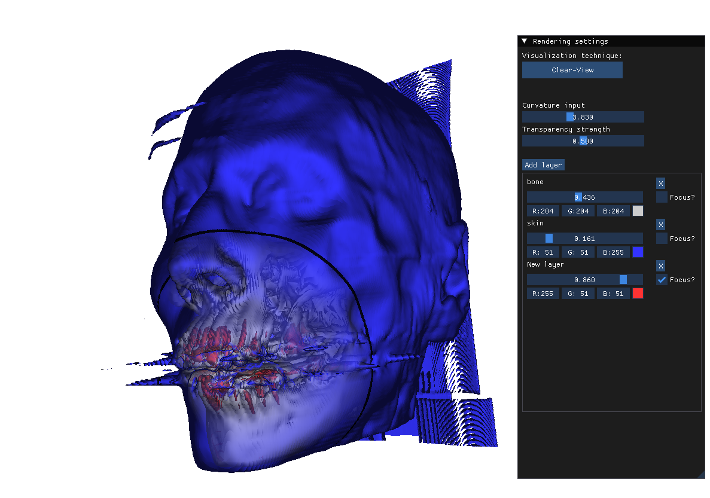
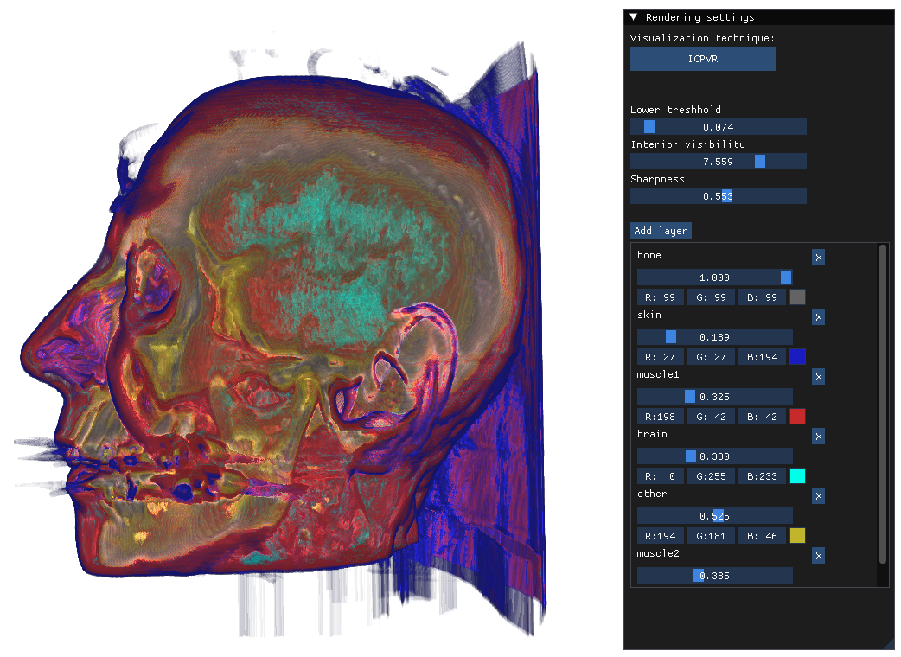
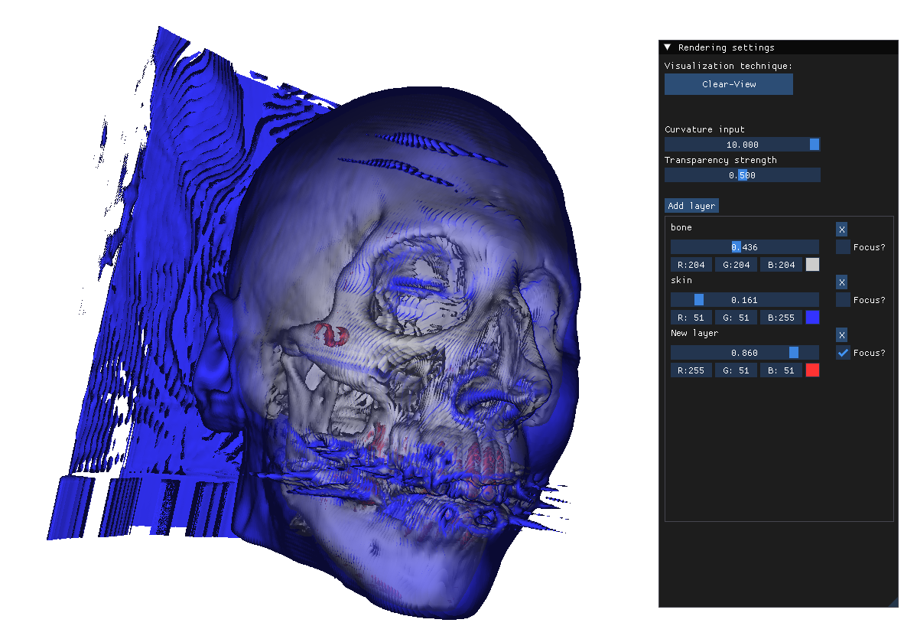
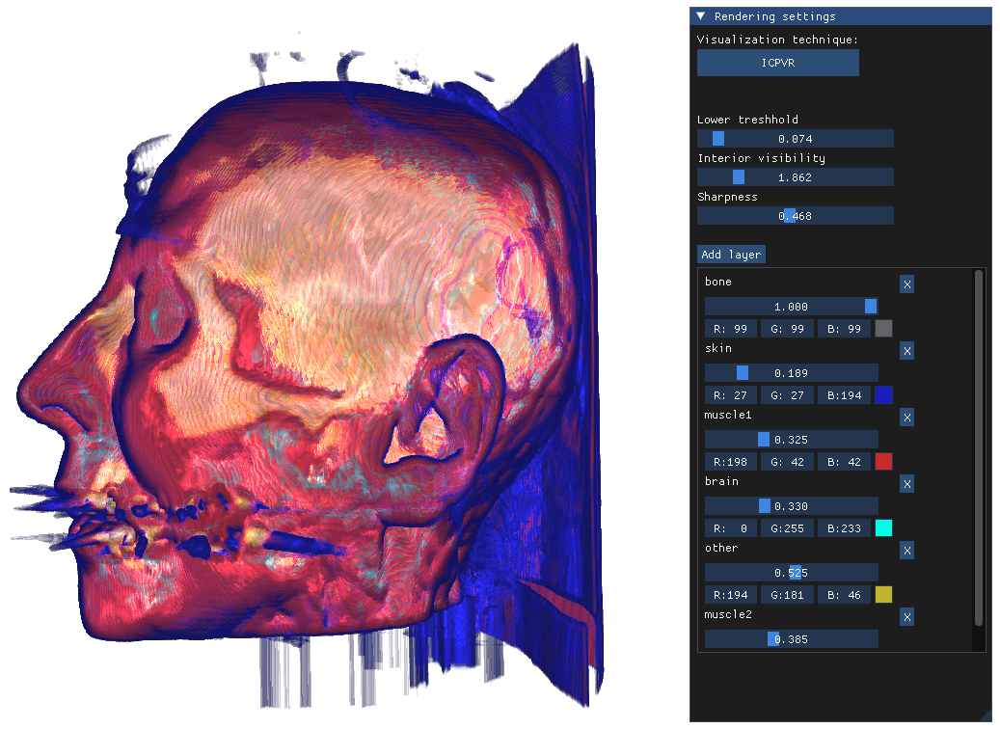
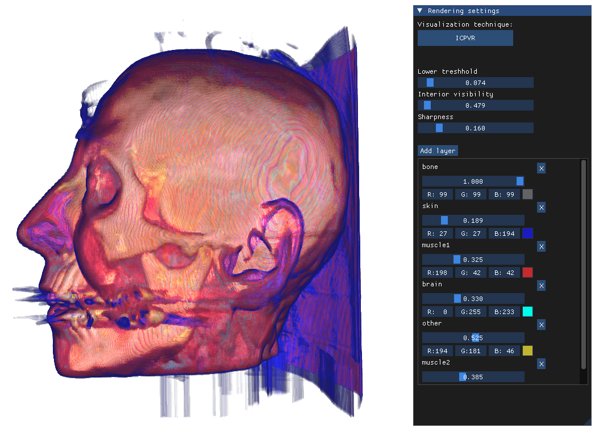

# Volume Viewer — illustrative rendering of CT data

Interactive GPU ray casting of a CT scan (C++17, OpenGL 3.3) with two illustrative
techniques that reveal the inside of the volume without losing the surrounding context:

- **ClearView** — several iso-surfaces with a focus lens that follows the cursor
- **ICPVR** — illustrative context-preserving direct volume rendering

| ClearView | ICPVR |
|---|---|
|  |  |

## Techniques

### ClearView

Based on J. Krüger, J. Schneider, R. Westermann:
*ClearView: An Interactive Context Preserving Hotspot Visualization Technique* (IEEE Visualization 2006).

The volume is shown as several iso-surface layers (for example skin and bone). Every layer
is ray-cast into offscreen textures in three passes:

1. position and depth of the first hit,
2. normal and shaded colour,
3. curvature — how quickly the normal changes between neighbouring pixels.

A final pass sorts the layers by depth and blends them. Inside the lens around the cursor
the outer layers fade out and the inner ones become visible. Highly curved areas stay more
opaque, which preserves the shape of the outer surface. Layers marked as *focus* are never
faded.

### ICPVR

Based on S. Bruckner, S. Grimm, A. Kanitsar, M. E. Gröller:
*Illustrative Context-Preserving Volume Rendering* (EuroVis 2005).

Direct volume rendering in which the opacity of every sample is its normalised gradient
magnitude raised to a power that depends on the shading intensity *s*, the distance from the
eye *d* and the opacity accumulated along the ray so far:

$$\alpha = \alpha_{tf} \cdot |\nabla f|^{\left(\kappa_t \, s \, (1 - d) \, (1 - \alpha_{acc})\right)^{\kappa_s}}$$

Flat and brightly lit regions close to the viewer become transparent, while boundaries with a
strong gradient — the contours of skin, bones and soft tissue — stay visible. *κt* controls the
visibility of the interior, *κs* the sharpness of the transition.

## Implementation

- A single fragment shader runs on a full-screen quad, one ray per pixel. The ray steps from
  one voxel boundary to the next and stops early once it is almost opaque.
- The ClearView passes render into 2D texture arrays (one array layer per iso-surface) using
  multiple render targets.
- Gradients are computed by central differences; the gradient magnitude is normalised with
  its range precomputed on the CPU.
- Up to 6 layers can be added, renamed and edited in the UI (iso-value, colour, focus).

## Controls

| Input | Action |
|---|---|
| Left mouse drag | Rotate the camera |
| Mouse wheel | Zoom |
| Mouse cursor | Position of the ClearView lens |
| Right mouse drag | Resize the ClearView lens |
| Settings panel | Switch the technique, edit layers and parameters |

## Building

Requirements: CMake 3.16+, a C++17 compiler and a GPU with OpenGL 3.3.
GLFW and GLM are downloaded automatically during the CMake configuration.

```bash
cmake -S . -B build
cmake --build build --config Release
```

Then run `build/Release/VolumeViewer.exe` (Windows) or `build/VolumeViewer` (Linux).
The shaders and the dataset are copied next to the executable.
Visual Studio can also open the folder directly (*File → Open → Folder*).

## Project structure

```
src/        C++ sources (window and camera, ClearView, ICPVR, volume loading)
shaders/    GLSL ray casting shaders
data/       CT dataset
docs/       screenshots
external/   bundled third-party code (Dear ImGui, glad, LodePNG)
```

## More screenshots

| | |
|---|---|
|  |  |
|  | |

## Credits

- CT head dataset: University of North Carolina, distributed through the
  [Stanford Volume Data Archive](https://graphics.stanford.edu/data/voldata/).
- [Dear ImGui](https://github.com/ocornut/imgui), [GLFW](https://www.glfw.org/),
  [GLM](https://github.com/g-truc/glm), [glad](https://github.com/Dav1dde/glad),
  [LodePNG](https://github.com/lvandeve/lodepng).
